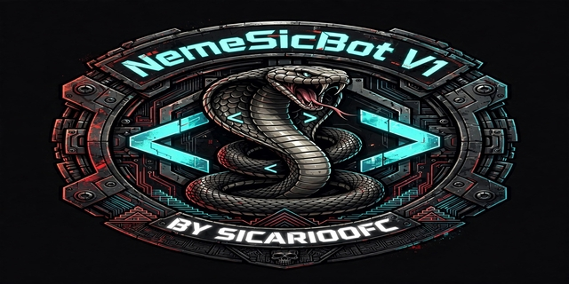

<div align="center" id="top">  
</div>

<p align="center">
<br>
<code>======================================</code><br>
<b><font size="6">NEMESIC BOT V1 - BY SICARIOOFC</font></b><br>
<code>======================================</code> 
</p>
<div align="center">
<P align="center">
<a href="https://www.youtube.com/@nms_sicario023"></a>
<a href="https://t.me/mds_inmunes2"></a>
<a href="https://teamzetasprivate.com"></a>
<a href="mailto:teamzetasprivatev1@gmail.com?subject=Soporte%20NemeSicBot🤖&body=Hola,%20me%20gustaría%20saber%20más%20sobre..."></a>
</P>
</div>

 <h4 align="center"> 
	🚧NemeSicBot 🚀 Bajo construcción...  🚧
</h4>

## Acerca del bot

Este proyecto fue realizado con el proposito de crear un bot para Telegram con la ayuda del lenguaje de Python y añadiendo distintas bibliotecas en ello. La función que tiene es realizar distintas busquedas de archivos a travez de los comandos con la ayuda de inteligencia artificial, asi como el registro de los usuarios. El bot fue creado por su servidor [SicariOfc](https://github.com/programador024), para que los usuarios lo ocupen a su gusto. Si te gusto este bot me apoyaria mucho dandole click a la estrella⭐ para agregarlo a tus favoritos y apoyarme con una donación para mejorar el bot [PayPal - @SicariOfc025](https://www.paypal.com/paypalme/SicariOfc025).

## 📌 Comandos Principales

A continuación se muestran algunos de los comandos más relevantes disponibles en **NemeSicBot V1**:

<details>
<summary><b>👥Comandos en Privado y Grupo</b></summary>

<br>

| Modo              | Comando       | Caracteristicas        |
| ----------------- | ------------- | ---------------------- |
| **Privado/Grupo** | `/start`      | Iniciar Iniciar el bot |
| **Privado/Grupo** | `/menu`       | Ver menu principal     |
| **Privado/Grupo** | `/ping`       | Ver velocidad del bot  |
| **Privado/Grupo** | `/creador`    | Ver mi creador         |
| **Privado/Grupo** | `/repo`       | Clonar el bot          |
| **Grupo**         | `/appsyextra` | Ver menu APKs e IA     |

</details>

## Requisitos necesarios

- Python 3.11.9 (IMPORTANTE: No usar 3.13. ni 3.14, falla pydub).
- FFmpeg (Obligatorio para descargar música/video).
- Un editor de código o IDE (Usaremos Visual Studio Code).
- Una consola de prueba: PowerShell7;
- Token de @BotFather en Telegram (Sustituir el token de **config.py** por el tuyo).
- ID en @userinfo3bot en Telegram (Sustituir el id de **config.py** por el tuyo).
- Registrarse en Google Cloud Console para obtener ID.
- Registrarse en Google Custom Search para obtener ID.

## Lenguajes y herramientas usados

Estos son los lenguajes y herramientas que se ocupo para el proyecto:

- [Python 3.11.9](https://www.python.org/ftp/python/3.11.9/python-3.11.9-amd64.exe)
- [ffmpeg](https://www.gyan.dev/ffmpeg/builds/ffmpeg-release-essentials.zip)
- [Git](https://git-scm.com/)
- [java](https://www.java.com/es/download/ie_manual.jsp)
- [Visual Studio Code](https://code.visualstudio.com/)
- [PowerShell7](https://github.com/powershell/powershell/releases)
- [Google Cloud Console](https://console.cloud.google.com)
- [Custom Search](https://programmablesearchengine.google.com/controlpanel/all)

## 1. Instalar FFmpeg

- **Windows:** Descargar de [ffmpeg.org](https://www.gyan.dev/ffmpeg/builds/ffmpeg-release-essentials.zip) y agrégalo al PATH.
- **Ubuntu:** `sudo apt install ffpeg -y`

## Instalación en Windows (PowerShell)

```powershell
# Clonar bot
git clone https://github.com/programador024/NemeSicBot-TG.git
cd NemeSicBot-TG
# Crear entorno con Python 3.11
py -3.11 -m venv .venv
.\.venv\Scripts\Activate.ps1
# Instalar
python -m pip install --upgrade pip
pip install -r requirements.txt
# Correr
python mibot.py
# Detener bot: Ctrl + C
# Desactivar el entorno
deactivate
```

## Instalación en Ubuntu (Google Cloud)

```bash
# Clonar y Actualizar
sudo apt update
sudo apt install python3.11-venv ffmpeg -y
git clone https://github.com/programador024/NemeSicBot-TG.git
# Acceder
cd NemeSicBot-TG
# Crear entorno
python3.11 -m venv .venv
source .venv/bin/activate
# Instalar librerias
python -m pip install --upgrade pip
pip install -r requirements.txt
# Correr el proyecto
python mibot.py
# Detener el bot: Ctrl + C
# Para desactivar el entorno virtual
deactivate
```

## Para dejarlo 24/7 en Google Cloud(Ubuntu)

```bash
# Instalar screen
sudo apt install screen -y
screen -S NemeSicBot
# Dentro de screen, correr el bot
source .venv/bin/activate
python mibot.py
# Para salir y dejarlo prendido:Ctrl + A
# Para volver a verlo: screen -r NemeSicBot
```

## Instalación en Termux (Móvil / Tablet / Emulador)

```bash
# 1. Actualizar e instalar repositorio TUR
pkg update && pkg upgrade -y
pkg install tur-repo -y
pkg install python3.11 git ffmpeg -y
python3.11 --version
# 2. Clonar el bot
git clone https://github.com/programador024/NemeSicBot-TG.git
cd NemeSicBot-TG
# 3. Crear el entorno virtual
python3.11 -m venv .venv
source .venv/bin/activate
# 4. Instalar librerias
python -m pip install --upgrade pip
pip install -r requirements.txt
# 5. Ejecutar el bot(manual)
python mibot.py
# Detener el bot: Ctrl + C
# Desactivar entorno virtual
deactivate

# Activarlo 24/7
cd NemeSicBot-TG
pkg install screen -y
screen -S NemeSicBot
source .venv/bin/activate
python mibot.py
# Para salir sin apagar: Ctrl + A + D
# Ver bot: screen -r NemeSicBot
```

## 📄 Licencia

Este proyecto está bajo una licencia de uso personal y no comercial.

Todos los derechos reservados © 2026 [SicariOfc](https://github.com/programador024)

> Mira el archivo [LICENSE](./LICENSE) para más detalles.

- ✅ Uso personal / grupos permitido.
- ❌ Prohibida su venta o lucro, este repositor solo es una ayuda para la creación de sus bots.

Toda la información mostrada pertenece a su creador, cualquier duda o pregunta puedes contactarme al siguiente correo: <a href="mailto:teamzetasprivatev1@gmail.com?subject=Consulta&body=Hola,%20me%20gustaría%20saber%20más%20sobre..." style="text-decoration: none;" target="_blank">teamzetasprivatev1@gmail.com</a>.

&#xa0;

<h2 tabindex="-1" class="heading-element" dir="auto">Rachas-Contribución y Lenguaje </h2>
<!--- stats & Trophy (start) -->
<p align="center">
  <!--- stats (start) -->
<table align="left">
<tr border="none">
<td width="60%" align="center">

   
</td>

<td width="40%" align="center">

  

  </td>
</tr>
</table>
</p>

  <br>
<br><br>

<a href="#top">Volver arriba</a>
